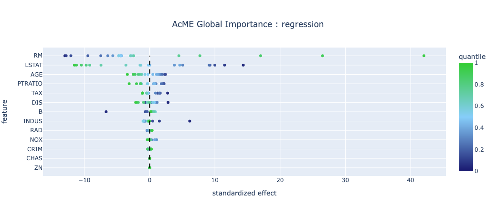
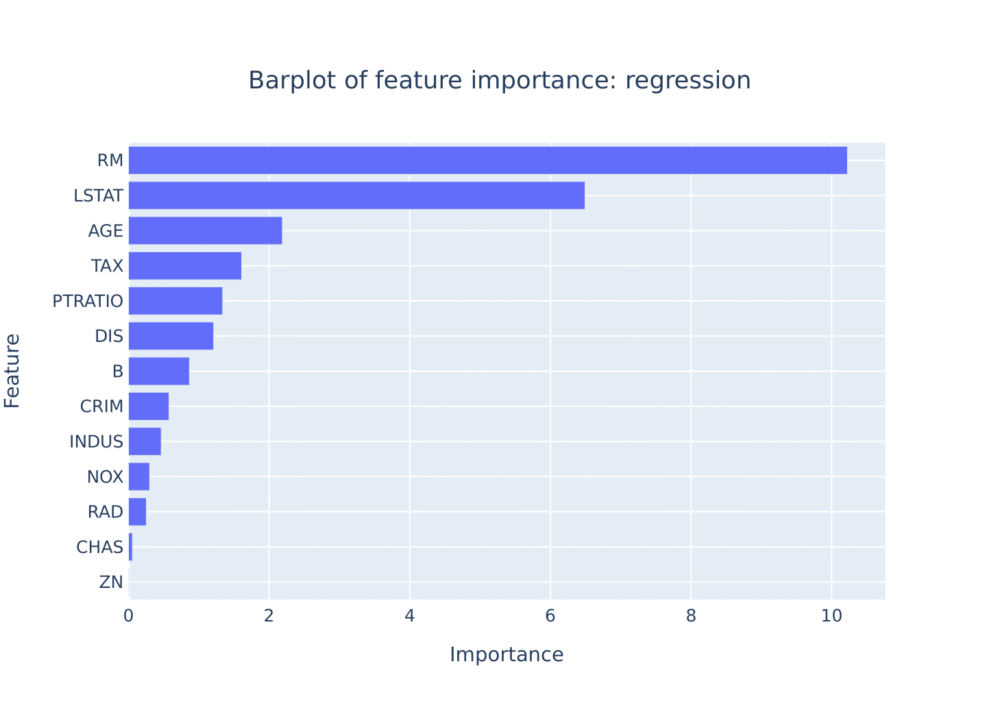
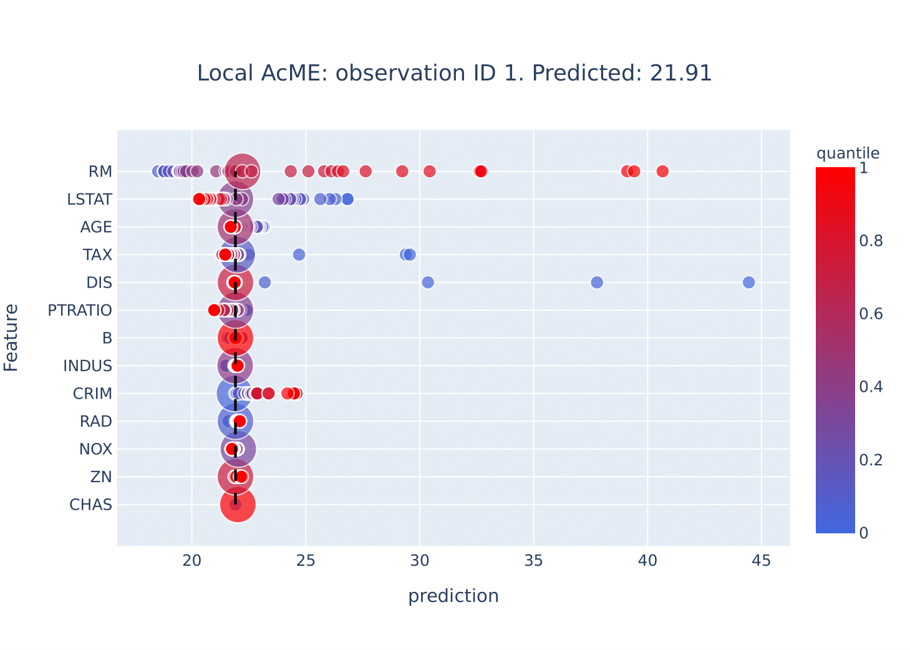
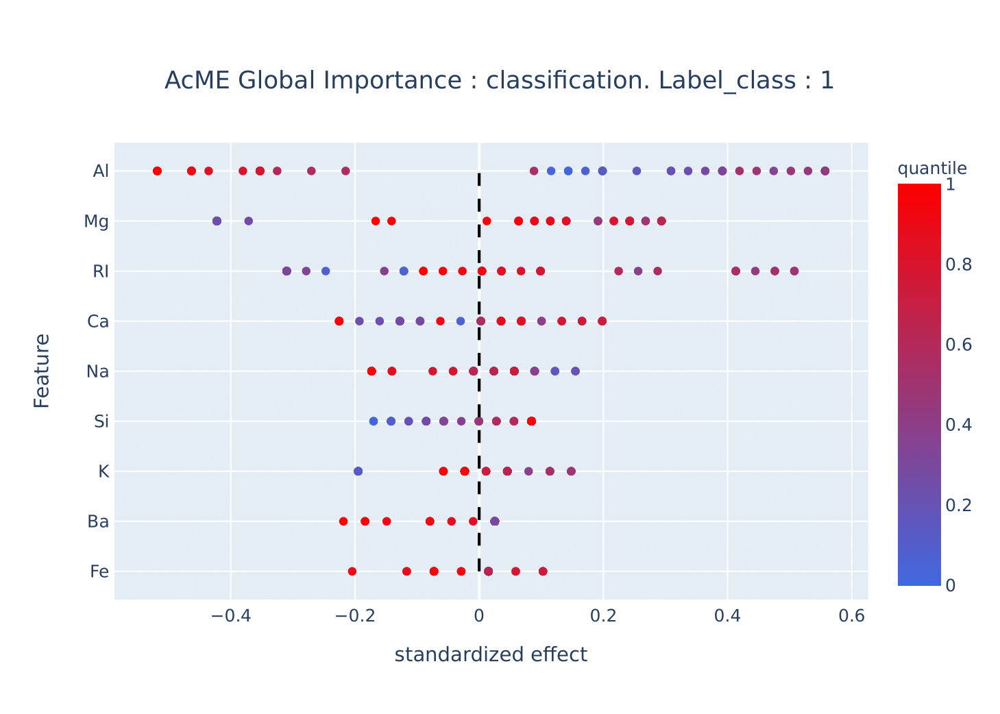

# ACME
ACME - Accelerated Model Explainability

ACME is a fast, model-agnostic explainability tool for machine learning models trained on **tabular data**. It answers two questions:

- **Global**: which features matter most to the model, and in which direction they push the prediction?
- **Local**: for a single observation, which features drive its prediction, and what would happen if we changed them ("what if" scenarios)?

Paper: [AcME—Accelerated model-agnostic explanations: Fast whitening of the machine-learning black box](https://www.sciencedirect.com/science/article/abs/pii/S0957417422021339) (Expert Systems with Applications).

ACME produces explanations very similar to SHAP, both in results and in visualization, but is much faster, which makes it well suited to applications where time efficiency is crucial.

## How it works

ACME studies how the model reacts when one feature at a time moves across its distribution, while all the others are held fixed.

1. **Baseline**: build a reference point from the data. For numeric features this is the mean, and for categorical features it is the mode. In local mode, the baseline is the observation being explained.
2. **Quantile perturbation**: for each feature, build `K` copies of the baseline in which only that feature is replaced by its quantiles, from 0 to 1 (or from 0.05 to 0.95 with `robust=True`). Categorical features are replaced by each of their levels.
3. **Predict**: score all the perturbed rows with the model (`predict`, `predict_proba` or a custom `score_function`). The cost is roughly `n_features × K` predictions, which is what makes ACME fast.
4. **Standardized effect**: for each perturbed row, `effect = prediction − baseline_prediction`. The effects are then standardized and rescaled by the feature's prediction range. This keeps both the **direction** of the change and the **amplitude** of the feature's overall impact.
5. **Importance**: a feature's importance is the mean absolute standardized effect over its quantiles.

### Anomaly detection importance

For anomaly detection, the model's score must lie in `[0, 1]`, where `0` means fully normal, `1` means fully anomalous, and the decision threshold is `0.5`. Local importance is then a weighted combination of four sub-scores, computed by perturbing each feature of the observation:

| Sub-score | Meaning |
|---|---|
| `delta` | range of anomaly scores reachable by changing only this feature |
| `ratio` | where the current score lies inside that range |
| `change` | `1` if changing this feature can flip the prediction (normal ↔ anomaly), else `0` |
| `distance` | how many quantiles away the flip happens (the closer, the more important) |

The default weights are `{'ratio': 0.2, 'distance': 0.2, 'change': 0.3, 'delta': 0.3}`.

## Supported tasks

| `task` | Model requirement |
|---|---|
| `'regression'` / `'reg'` / `'r'` | `model.predict(X)` |
| `'classification'` / `'class'` / `'c'` | `model.predict_proba(X)` and `model.classes_` |
| `'anomaly detection'` / `'ad'` | a `score_function` returning a score in `[0, 1]` (0 = normal, 1 = anomaly, threshold at 0.5) |
| any task | when a `score_function(model, X)` is given, it is used instead of `predict` / `predict_proba` |

`X` is passed to the model as a **NumPy array** with columns in the order of `features`.

## Install

```bash
pip install statwolfACME
```

## API

```python
from ACME.ACME import ACME
```

All methods that fit something (`explain`, `explain_local`) return `self`, so calls can be chained. Every method that has a `local` parameter works on the **global** explanation by default. With `local=True`, it uses the last observation passed to `explain_local`.

<details>
  <summary><b>ACME(model, target, features=[], cat_features=[], K=50, task='regression', score_function=None)</b></summary>

Initialization.

    Params:

    - model : object
        the trained model. It must have `predict` (regression) or `predict_proba` (classification),
        unless a `score_function` is given

    - target : str
        name of the target column in the dataframe passed to `explain`. Typically it is the model
        prediction (regression and classification). With a score function it can be any score column
        (e.g. the anomaly score in anomaly detection). This column is excluded from the features

    - features : [str]
        names of all the model features, in the SAME ORDER as the model input

    - cat_features : [str]
        names of the categorical features (a subset of `features`)

    - K : int (default 50)
        number of quantiles used for each numeric feature. Higher K means a finer grid and more predictions

    - task : str (default 'regression')
        one of {'regression','reg','r', 'classification','class','c', 'anomaly detection','ad'}

    - score_function : function(model, X) -> array (default None)
        custom scoring function. It receives the model and a 2D numpy array and must return one numeric
        score per row. Required for anomaly detection, where the score must be in [0, 1]

</details>

<br>

<details>
  <summary><b>ACME.explain(dataframe, robust=False, label_class=None)</b></summary>

Fit the global explanation. Use the same data (or a representative sample of the data) the model was trained on.

    Params:

    - dataframe : pd.DataFrame
        input data containing the features and the `target` column

    - robust : bool (default False)
        if True use only quantiles in [0.05, 0.95], excluding possible outliers

    - label_class : str, int (default None)
        classification only. The class to explain (a value in `model.classes_`).
        If None, all the classes are explained, and the global summary plot becomes a stacked
        bar plot with the importance per class

    Returns:

    - self

</details>

<br>

<details>
  <summary><b>ACME.explain_local(series, label_class=None)</b></summary>

Explain the prediction of a single observation. `explain` must be called first, because the local explanation reuses the global quantile grid.

    Params:

    - series : pd.Series
        the observation to explain, containing the features (e.g. `df.loc[idx, features]`).
        Its name (the dataframe index) is shown in the local plots

    - label_class : str, int (default None)
        classification only. The class to explain. If None, the first class in `model.classes_` is used
        and a warning is printed

    Returns:

    - self

</details>

<br>

<details>
  <summary><b>ACME.feature_importance(local=False, weights={}, sum_local=False)</b></summary>

Return the feature importance table, sorted from the most to the least important feature.
For anomaly detection with `local=True`, it returns the ad hoc anomaly detection importance, which shows which features can move the prediction from normal to anomaly and vice versa.

    Params:

    - local : bool (default False)
        if True return the importance of the last local explanation

    - weights : dict (default {})
        anomaly detection only. Weights of the four sub-scores, which must sum to 1.
        An empty dict uses the default weights; otherwise all four keys are required
        - ratio : float      importance of the local score position
        - distance : float   importance of the inter-quantile distance needed to change the prediction
        - change : float     importance of the possibility to change the prediction
        - delta : float      importance of the score delta

    - sum_local : bool (default False)
        anomaly detection only. If True, add this local importance to an accumulator,
        used by `bar_plot()` to show the aggregated importance over many anomalies

    Returns:

    - pd.DataFrame
        index: feature, column `importance` (for local AD also `ratio`, `delta`, `change`,
        `distance_to_change`, `min_score`, `max_score`, `local_score`)

</details>

<br>

<details>
  <summary><b>ACME.summary_plot(local=False, weights={}, n_features=None)</b></summary>

Generate the summary plot. Each row is a feature, sorted by importance. Each point is a quantile of that feature, and its x position is the standardized effect (or, for local plots, the prediction obtained with that quantile). The color is the quantile.

    Params:

    - local : bool (default False)
        if True plot the local explanation, else the global one

    - weights : dict (default {})
        anomaly detection only, same as in `feature_importance`

    - n_features : int (default None)
        plot only the `n_features` most important features

    Returns:

    - plotly figure

</details>

<br>

<details>
  <summary><b>ACME.bar_plot(local=False, n_features=None)</b></summary>

Horizontal bar plot of the feature importance.
For anomaly detection with `local=False`, if local scores were accumulated (see `sum_local_scores`), the plot shows the aggregated local importance. Otherwise it shows the global importance.

    Params:

    - local : bool (default False)
        if True plot the local importance, else the global one

    - n_features : int (default None)
        plot only the `n_features` most important features

    Returns:

    - plotly figure

</details>

<br>

<details>
  <summary><b>ACME.feature_exploration(feature, local=False, plot=False)</b></summary>

Show how the prediction changes when the selected feature moves across its quantiles (a "what if" analysis).
For anomaly detection, each quantile is also labelled `normal` or `anomalies` depending on whether the resulting score crosses 0.5.

    Params:

    - feature : str
        name of the feature to explore

    - local : bool (default False)
        if True explore the local explanation, else the global one

    - plot : bool (default False)
        if True return a plotly figure, else return the table

    Returns:

    - pd.DataFrame or plotly figure

</details>

<br>

<details>
  <summary><b>ACME.sum_local_scores(dataframe)</b> &nbsp;/&nbsp; <b>ACME.reset_local_sum_importance()</b></summary>

Anomaly detection only. `sum_local_scores` runs `explain_local` and `feature_importance(local=True, sum_local=True)` on every row of `dataframe` and accumulates the local importance. `bar_plot()` then shows which features explain that group of anomalies.

`reset_local_sum_importance` resets the accumulator, which is useful for analysing several clusters of anomalies with the same fitted object.

    Params:

    - dataframe : pd.DataFrame
        observations to explain (typically the detected anomalies). It must contain the features

</details>

<br>

<details>
  <summary><b>ACME.summary_table(local=False)</b></summary>

Return the global or local table with everything computed by ACME, with one row per (feature, quantile).

    Columns:

    - effect               standardized effect
    - predict              prediction with the feature set to that quantile
    - baseline_prediction  prediction on the baseline
    - original             original value of the feature at that quantile
    - quantile             quantile in [0, 1]
    - type_feature         'numeric' or 'categorical'
    - baseline_quantile    quantile of the baseline value
    - importance           feature importance
    - class                classification only

</details>

<br>

<details>
  <summary><b>ACME.baseline_values(local=False)</b></summary>

Return the baseline used by ACME: the mean/mode vector (global) or the explained observation (local).

    Params:

    - local : bool (default False)
        if True return the local baseline, else the global one

</details>

<br>

<details>
  <summary><b>ACME.metadata()</b></summary>

Return a dict with the model, the target, the features, the task, K, the score function, and the raw global and local explanations.

</details>

<br>

## Examples

### Full example (regression)

```python
from sklearn.datasets import load_diabetes
from sklearn.ensemble import RandomForestRegressor
from ACME.ACME import ACME

X, y = load_diabetes(return_X_y=True, as_frame=True)
features = X.columns.to_list()
model = RandomForestRegressor(random_state=0).fit(X, y)

# the target column is the model prediction
dataset = X.copy()
dataset['target'] = model.predict(X)

# 1) global explanation
acme = ACME(model, 'target', features=features, K=50)
acme = acme.explain(dataset)

acme.feature_importance()          # importance table
acme.summary_plot().show()         # quantile/effect plot
acme.bar_plot(n_features=5).show() # top 5 features
acme.feature_exploration('bmi', plot=True).show()

# 2) local explanation of observation 100
acme.explain_local(dataset.loc[100, features])
acme.feature_importance(local=True)
acme.summary_plot(local=True).show()
acme.summary_table(local=True)     # all the numbers behind the plot
```

<br>

<details>
    <summary><b> REGRESSION </b></summary>

```python
acme_reg = ACME(model, 'target', features=features, K=50)
acme_reg = acme_reg.explain(dataset)
```

```python
acme_reg.summary_plot()
```



```python
acme_reg.bar_plot()
```



<b>LOCAL</b>

```python
acme_reg.explain_local(dataset.loc[100, features])
acme_reg.summary_plot(local=True)
```



</details>

<br>

<details>
    <summary><b> CLASSIFICATION </b></summary>

Classification works like regression, but you specify the class to explain in `explain` / `explain_local`.

```python
model.classes_
array([0, 1])
```

```python
acme_class = ACME(model, 'target', features=features, K=50, task='class')
acme_class = acme_class.explain(dataset, label_class=1)
acme_class.summary_plot()
```



Without `label_class`, all the classes are explained and `summary_plot()` shows a stacked bar plot of the importance per class:

```python
acme_all = ACME(model, 'target', features=features, task='class').explain(dataset)
acme_all.summary_plot()
```

Local:

```python
acme_class.explain_local(dataset.loc[10, features], label_class=1)
acme_class.summary_plot(local=True)
```

</details>

<br>

<details>
    <summary><b> ANOMALY DETECTION with SCORE FUNCTION </b></summary>

In this case the model is an Isolation Forest. Its `decision_function` is mapped to `[0, 1]` (0 = normal, 1 = anomaly).

```python
from sklearn.ensemble import IsolationForest

ifo = IsolationForest(random_state=0).fit(X)

def score_function(model, data):
    # reshape so that it works for both many rows (global) and a single row (local)
    return (-model.decision_function(data.reshape(-1, len(features))) + 1) / 2

dataset = X.copy()
dataset['AD_score'] = score_function(ifo, X.values)

acme_ifo = ACME(ifo, 'AD_score', features=features, K=50, task='ad', score_function=score_function)
acme_ifo = acme_ifo.explain(dataset, robust=True)

# explain the most anomalous observation
idx = dataset['AD_score'].idxmax()
acme_ifo.explain_local(dataset.loc[idx, features])

acme_ifo.feature_importance(local=True)       # ratio, delta, change, distance_to_change, importance
acme_ifo.summary_plot(local=True)
acme_ifo.feature_exploration('bmi', local=True, plot=True)  # which values make it normal again?

# aggregate the local importance over the top 20 anomalies
acme_ifo.sum_local_scores(dataset.nlargest(20, 'AD_score'))
acme_ifo.bar_plot()
acme_ifo.reset_local_sum_importance()
```

</details>

More examples, including comparisons with SHAP and industrial anomaly detection use cases, are in the [notebook](notebook) folder.
